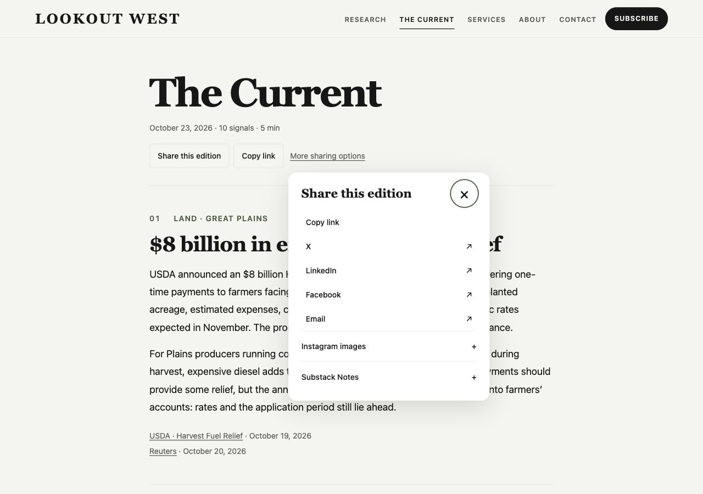
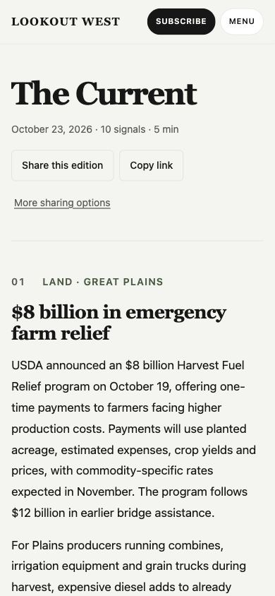
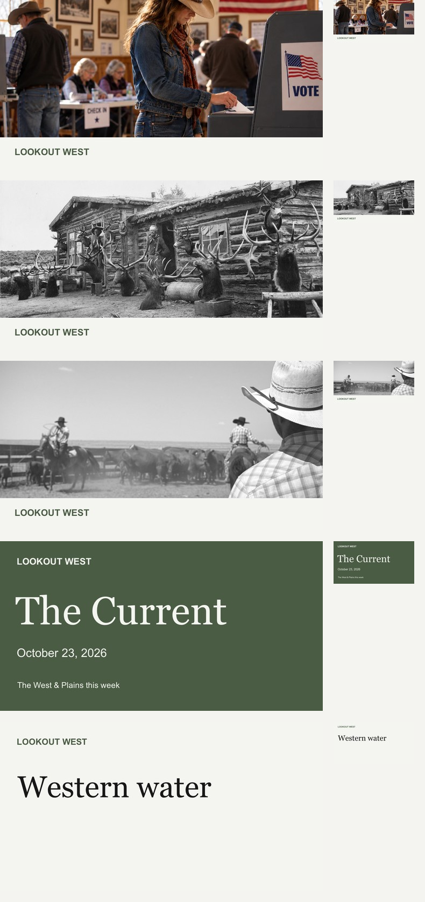

# Sharing review — October 29, 2026

Sharing and energy release review. [Authoring and architecture](../sharing-implementation.md).

## Browser screenshots

Actual Chrome captures of the production build. Responsive checks measured
1280×900 desktop and 390×844 mobile CSS viewports, with no horizontal overflow.
A further 320×800 check confirmed 44px touch targets, no horizontal overflow,
and a fully contained dialog that closes on Escape and restores focus.
The connected browser was zoomed; delivered Current/mobile captures crop the
capture API's extra empty right/bottom margin to the measured page viewport.
No page content was synthesized or retouched.

| Page | Closed controls | Open options |
| --- | --- | --- |
| Current, desktop | [Closed](current-desktop-closed.jpg) | [Open](current-desktop-open.jpg) |
| Current, mobile | [Closed](current-mobile-closed.jpg) | [Open](current-mobile-open.jpg) |
| Election article, desktop | [Closed](desktop-closed.jpg) | [Open](desktop-open.jpg) |
| Election article, mobile | [Closed](mobile-closed.jpg) | [Open](mobile-open.jpg) |

[Expanded Instagram actions on mobile](mobile-instagram.jpg).

[Restored energy calculator on desktop](energy-desktop.jpg) and
[mobile](energy-mobile.jpg). The mobile capture shows the actual calculator at
390 CSS pixels; a 320-pixel check also found no horizontal overflow and 44-pixel
preset/reset targets. Browser checks covered calculation, invalid input, reset,
and negative price changes, with no console errors.

## Social artwork

The actual generated JPEGs, inspected at source size, 600×315, and 150×79
(approximately 150×80). Photo sources are the existing article assets; typography
and Current cards use the publication's palette and existing font choices.

| Template/sample | 1200×630 | 600×315 | Small thumbnail |
| --- | --- | --- | --- |
| Election research | [Full](ballot-1200.jpg) | [Reduced](ballot-600.jpg) | [Thumbnail](ballot-150.jpg) |
| Resident priority | [Full](resident-1200.jpg) | [Reduced](resident-600.jpg) | [Thumbnail](resident-150.jpg) |
| Cattle research | [Full](cattle-1200.jpg) | [Reduced](cattle-600.jpg) | [Thumbnail](cattle-150.jpg) |
| Current, October 23 | [Full](current-1200.jpg) | [Reduced](current-600.jpg) | [Thumbnail](current-150.jpg) |
| Typography fallback example | [Full](typography-1200.jpg) | [Reduced](typography-600.jpg) | [Thumbnail](typography-150.jpg) |

The typography example is review artwork, not a new article or an editorial claim.

## Results

- `npm run build`: passed; 44 static pages, including 11 research articles, four dated editions, the Current landing page, and twelve chart routes.
- `npm run check`: passed; 107 files, zero errors, warnings, or hints.
- `npm run lint`: passed. The repository's previously missing ESLint config is now present; three existing HTML nesting errors were corrected without changing their text.
- Sharing, Current, subscription, and ballot-navigation suites: **28/28 passed**. Tests inspect built HTML and decoded image files, exercise direct synchronous native sharing, quiet cancellation, failed/unsupported handoffs, clipboard denial, modal dismissal/focus, repeated initialization, lazy file preparation, permanent edition links, platform encoding, both placements, and chart routes/anchors.
- Full suite: **63/63 passed**, including **35/35 energy tests**. Restored the missing household calculator and its accessible controls/static fallback; removed the state-price comparison's required dependency on the calculator label; and moved initial rendering ahead of listener registration so failed setup does not leave handlers behind. A regression test verifies state/fuel switching without the calculator. Updated stale fiscal and closing-art selectors to assert the existing editorial content, and chart-preview checks now decode the content-hashed image files. Energy arithmetic and published data are unchanged.
- The metadata regression test covers all 11 research articles (including `.md`), all four editions, and the evergreen landing page. It checks exactly one set of canonical/OG/Twitter tags, date-specific titles and images, HTTPS URLs, nonempty editorial descriptions, no accidental `noindex`, content-hashed paths, and decoded 1200×630 JPEG files. Chart tests preserve their intentional utility-page indexing behavior.
- Local HTTP image checks: all five representative research/edition previews returned **200 image/jpeg**. Election: 159,691 bytes; resident priority: 218,752; cattle: 89,127; October 23 Current: 45,826; October 16 Current: 45,517.
- Sharing JavaScript: **6,256 bytes**, **2,311 gzip**, with no third-party scripts or dependencies added.
- All **46 existing Instagram article/chart exports are byte-for-byte unchanged** against the untouched generator output. Current gets new 1080×1350 and 1080×1920 exports. The Chrome Post download completed and decoded as JPEG, 1080×1350.
- Chrome visual/interaction review: desktop/mobile closed and open states, Enter-key opening, Escape dismissal/focus restoration, copy confirmation, readable Instagram instructions and downloads, and correct dated edition payloads. The native link-share attempt failed in the connected browser and correctly revealed the fallback; it did not claim success. File-share availability was detected after expanding Instagram, but no image was sent to another app.

## Still requiring external checks

Production deploys through the existing Cloudflare Pages integration when `main`
is pushed. Real iOS/Android OS share sheets, Safari save behavior, Instagram app
handoff/link stickers, and newly deployed LinkedIn,
Meta, X, iMessage, and WhatsApp previews require manual platform testing. No social
post or message was sent. See the [release steps and cache guidance](../sharing-implementation.md#verification-and-release).
