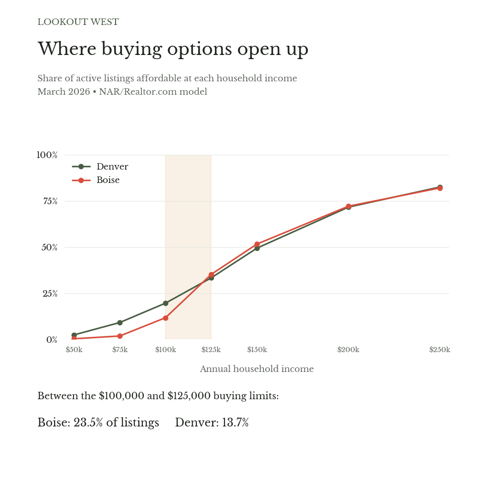

# What $100,000 Buys in the West and Plains

**An improving housing market can still leave a household with few choices. Denver and Boise show where the recovery reaches buyers—and where it stops.**

*Lookout West | November 6, 2026 | Affordability observations — March 2026*

When you shop for a home, the monthly payment you can live with becomes a number in a search box. Everything above that price disappears from the map. How much is left can help decide whether you start booking showings or renew your lease.

By spring 2026, rising inventory, income growth and mortgage rates in the low 6% range were offering buyers some relief nationally. Yet sales remained sluggish, according to Realtor.com’s analysis of the March market.[1]

Around Boise, a household earning $100,000 could afford about one in nine homes listed for sale in March 2026. Around Denver, the same income put about one in five within reach. At $125,000, both households could shop about a third of their market.[2]

The two budgets show how uneven access remains. A household can earn a good living and still sit below the prices at which much of its local housing is available. Getting past that point may require a substantial increase in income, even as headlines describe an improving market.

Lower borrowing costs help by letting the same paycheck support a larger loan. Lower asking prices bring homes closer to an existing budget. How much either helps a search depends on what is for sale near that budget.

## Where the search opens up

The modeled buying limit for a $100,000 household was about $386,000 in both Denver and Boise. At $125,000, it rose to about $483,000. Nearly a quarter of Boise’s listings fell between those prices. In Denver it was about one in seven. That’s how the share within reach tripled in Boise between the two incomes, from 11.7% to 35.2%, while Denver’s rose from 19.6% to 33.3%.

*Source — NAR/Realtor.com, March 2026 observations; Lookout West calculations. Shares include all listings below each income’s modeled buying limit.*

A separate public dataset puts Boise’s median asking price about 8% above the price below which NAR places half its listings. That unresolved mismatch limits confidence in the precise Boise estimates, although it cannot tell us how to adjust the shares in this lower price band.[3]

That wider search requires $25,000 more in annual household income—a 25% increase.

NAR’s figures show a similar concentration a year earlier. Between the same two income budgets, Boise’s band accounted for 25.2% of listings in March 2025 and 23.5% in March 2026, compared with 12.6% and 13.7% in Denver.

At $75,000, the search was tighter still. About 9% of Denver listings and fewer than 2% of Boise’s were within reach. Those households would need considerably more relief before they could shop the price range where Boise’s choices begin to widen.

In Canyon County, which includes Nampa and Caldwell, the median resale home went for $406,000 in March. The median newly built home sold for about $450,000. Both were above the $100,000 household’s modeled limit and below the $125,000 household’s limit. In that part of the Boise metro, the gap between the two budgets covered prices at which both new and existing homes were selling.[4]

Denver’s local Realtors association put the March median sale price for attached homes at $397,000, roughly $11,000 above the modeled limit for a $100,000 household. A condo priced within that limit can still stretch the monthly budget once association dues are added.[5]

A $100,000 income also occupies a different place in each local economy. NAR’s table puts about 54% of Boise households below that income, compared with 44% in Denver. The Boise household sits higher on its local income ladder while facing a smaller affordable share of listings.[2]

## The view from Seattle to Wichita

Boise combined a low starting point with a large gain at the higher income. Of the six metros with the largest increases across these budgets, Boise had the smallest share within reach at $100,000.[6]

Each metro uses its own buying limits, so these comparisons cover different dollar price bands. Denver and Boise happen to have nearly identical limits.

*Six largest gains across the two incomes*

| Metro | Listings affordable at $100,000 | At $125,000 | Gain, percentage points |
|---|---:|---:|---:|
| El Paso | 51.8% | 77.7% | 25.9 |
| Fresno | 20.7% | 46.6% | 25.9 |
| Colorado Springs | 20.2% | 44.0% | 23.8 |
| Bakersfield | 37.4% | 61.1% | 23.7 |
| Albuquerque | 40.9% | 64.5% | 23.6 |
| Boise | 11.7% | 35.2% | 23.5 |

*Three comparison metros*

| Metro | Listings affordable at $100,000 | At $125,000 | Gain, percentage points |
|---|---:|---:|---:|
| Wichita | 63.1% | 77.1% | 14.0 |
| Denver | 19.6% | 33.3% | 13.7 |
| Seattle | 7.7% | 15.1% | 7.4 |

*Source — NAR/Realtor.com, March 2026; Lookout West calculations. Selected metros from the 33-metro Western and Plains comparison.*

A large jump tells us where listings cluster. The starting point tells us how restricted the search was to begin with. Fresno and El Paso gained the same 25.9 percentage points between the two incomes. Yet the higher budget reached fewer than half of Fresno’s listings and more than three-quarters of El Paso’s.

Wichita already offered a $100,000 household access to most listings. In Seattle, even at $125,000, only about one in seven was within reach. These are comparisons of the same dollar income. About 65% of Wichita households earned less than $100,000, compared with 40% in Seattle.[2]

## How much of the recovery reaches you?

Denver’s affordable share rose at each of the four incomes below between March 2025 and March 2026. Boise barely changed at $100,000, while its shares fell at the two higher incomes.[7]

| Household income | Denver, 2025 → 2026 | Boise, 2025 → 2026 |
|---|---:|---:|
| $75,000 | 6.6% → 9.1% | 1.3% → 1.8% |
| $100,000 | 16.3% → 19.6% | 11.6% → 11.7% |
| $125,000 | 28.9% → 33.3% | 36.8% → 35.2% |
| $150,000 | 45.2% → 49.4% | 54.5% → 51.6% |

*Source — NAR/Realtor.com. Share of listings within reach in March of each year.*

At $100,000, Denver’s improvement still left four out of five listings above the modeled limit. Boise’s share stayed close to one in nine. A household reading that the market had improved could reasonably find little relief in its own search.

Consider a hypothetical household earning $100,000 in Denver and weighing a $125,000 offer in Boise. Under March’s modeled budgets, its search would expand from about one in five listings to about one in three. The pay increase would buy a wider search, though most listings would still be beyond its limit.

For a household hoping to stay near family, moving to a cheaper city may hold little appeal. Renting longer may be the best available choice while it waits for a home that fits its budget.

The March figures show why those choices can remain difficult as the market improves. More listings only expand a household’s immediate search if some fall within its buying limit. Easier borrowing helps when the higher limit reaches homes it could not previously consider. In Boise, most listings sat beyond the $100,000 household’s budget, and a year of change had done almost nothing to widen its share.

For that household, recovery would mean being able to consider more homes on the income it already earns. For a parent hoping an adult child can settle nearby, it could mean the same thing. Denver’s figures showed some movement in that direction. Boise’s showed how far an improving national market could remain from a workable local home search.

---

### Endnotes

1. [Realtor.com’s May 2026 report](https://www.realtor.com/research/2026-affordability-report-nar/) describes the national March backdrop of rising inventory, growing incomes and mortgage rates in the low 6% range, alongside sluggish sales activity. These national developments do not establish the separate contributions to either metro’s annual change.

2. The March 2026 shares and buying limits come from [NAR and Realtor.com’s metro tables](https://www.nar.realtor/sites/default/files/2026-05/Metro-Area-Affordability-Listings-2026-05-20.pdf). The [model](https://www.nar.realtor/research-and-statistics/housing-statistics/realtors-affordability-distribution-curve-and-score/methodology) budgets 30% of gross income for mortgage payments, property taxes and homeowners insurance. It assumes a 30-year fixed mortgage, varies the down payment and includes mortgage insurance where required. Loan approval and cash at closing are separate. The chart uses cumulative shares at published incomes. The buying limits and shares come from the same NAR release. Income-distribution percentages use the report’s published household-income shares.

3. A same-month check against [Realtor.com’s public inventory file](https://econdata.s3-us-west-2.amazonaws.com/Reports/Core/RDC_Inventory_Core_Metrics_Metro_History.csv) found an unresolved discrepancy. NAR reports 51.6% of Boise listings below $579,400. That would put the median at or below that price if both sources covered the same listings and used the same price measure. The public file instead reports a March median of $624,987, a gap of at least $45,587, or 7.9% of NAR’s cutoff. Denver’s mismatch is much smaller—NAR reports 49.4% below $579,110, while the public median is $575,000, a difference of $4,110, or 0.7%. Coverage or processing differences may be relevant, but the cause is unconfirmed. The public median alone cannot establish corrected affordable shares or the size of Boise’s band. All affordability comparisons here use NAR’s tables consistently. The [methods note](Lookout_West_Housing_Methods.md) documents the check.

4. [Boise Regional Realtors’ Canyon County report](https://www.boirealtors.com/wp-content/uploads/2026/04/March-2026-Market-Stat-Sheets-Canyon.pdf) covers March single-family sales in the county. The Boise metro also includes Ada County. NAR counts active listings across the metro, so the county sales illustrate prices and cannot establish the mix of listings in the metro’s price band.

5. The [Denver Metro Association of Realtors’ March sales tables](https://www.dmarealtors.com/sites/default/files/file/2026-04/DMAR_MarketTrendsReport_Mar26Data.pdf) cover closed sales in its local market. Association dues are outside the published NAR cost components. Its geography differs from NAR’s metro, and closed-sale medians do not show the share of active listings below a buyer’s limit.

6. The regional comparison uses the 33 Western and Plains metros covered in the report, with metro-specific buying limits at each income. A metro’s gain is the difference between its two cumulative shares. See the [regional data](data/regional_budget_band_comparison.csv) and [replication code](reproduce_analysis.py). At $100,000 income, buying limits range from $295,310 in McAllen to $430,470 in San Jose. Denver and Boise happen to have nearly identical limits.

7. These are two March snapshots, not an established trend. Shares can move with the number and mix of listings as well as buying power. A falling share can coincide with a rising count if total inventory grows enough. Household situations in the closing paragraphs illustrate decisions a reader might face. They are not interviews or composites, and this analysis does not estimate effects on migration or employment.
